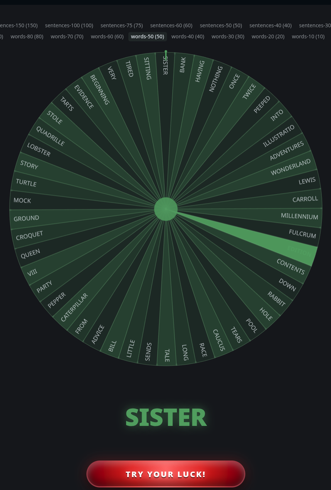

# WheelSpin

A real spinning wheel for Hermes. Any list becomes a weighted wheel in the
Desktop app; press **Try your luck** and it spins under friction physics, clicks
peg-by-peg to a stop, and announces the winner in the conversation.

A few options on every wheel are hidden **jackpots**. Land on one and the wheel
gives way to a three-reel slot machine, locks 7-7-7, and fires **JACKPOT!!!**
with a fanfare.



```
╭────────────── wheel: dinner ───────────────╮
│▓▓▓▓▓▓▓▓▓░░░░░░░░░████▼████░░░░░░░░░▓▓▓▓▓▓▓▓│
╰────────────────────────────────────────────╯
★  3 SUSHI ██········  20.0%
·  1 PIZZA ██········  20.0%
·  2 THAI  ██········  20.0%
·  4 RAMEN ██········  20.0%
·  5 TACOS ██········  20.0%
```

## Demo

[`demo/wheelspin-demo.mp4`](demo/wheelspin-demo.mp4) — 54 seconds, silent, recorded
in the Desktop app: a list goes on the wheel, **Try Your Luck!** spins it, the
winner lands under the pointer and posts into the chat.

The screenshot above is a frame from that video.

## Install

```bash
hermes plugins install wheelspin
```

Then enable it in **Settings ▸ Plugins** (the Desktop half is opt-in) and open
the **wheel** pane. The agent tools work without the pane, so CLI, TUI, Discord
and cron all get the text wheel.

## Use

Ask Hermes in plain language:

> make a wheel of dinner options: pizza, thai, sushi, ramen, tacos

> put my Steam backlog on a wheel and spin it

> spin the wheel for me — I don't care, just pick

The agent calls `wheelspin_load` (or `wheelspin_spin` for an instant draw), and
the wheel appears in the pane. Press **Try your luck**.

## How it works

- **Weighted, not rigged.** Each option holds integer tickets; the draw is
  `secrets.randbelow(total)`. Weights are exact — no float rounding, no bias.
- **Physics, not an easing curve.** The wheel integrates `dω/dt = -K·ω - μ`
  (viscous drag plus constant bearing friction) every frame, so it rips at the
  start and hangs in the long tail. The initial angular velocity is solved by
  bisection so the wheel stops exactly on the sector the backend drew.
- **One draw, two surfaces.** The pane and the agent tool share one store
  (`plugin-data/wheelspin/wheels.json`, atomic writes under an advisory lock), so
  a click and a tool call are the same draw.
- **Big wheels stay readable.** Every option is a real sector, and the label is
  sized from the room that sector actually has — arc length on the rim sets the
  font, radial length sets how many characters fit — so a 50-item wheel still
  names its options and a 500-item one degrades to ticks rather than mush.
- **Labels are upper-case at draw time**, not in the data: the store keeps what
  you typed (the agent still matches names case-insensitively), and the canvas,
  the winner line and the CLI art all render upper-case.
- **Jackpots are cosmetic.** 1–3 options per wheel are flagged at random
  (about one per five, capped at three). They never change the odds; a jackpot is
  only revealed if the winner happens to be one. The store does not expose which
  options they are, so the reveal cannot be peeked at.

## Tools

| Tool | Purpose |
|---|---|
| `wheelspin_load` | Load a list onto the wheel (`replace` or `append`) |
| `wheelspin_spin` | Draw immediately, no UI — CLI, gateway, cron |
| `wheelspin_list` | Loaded wheels, item counts, recent results |
| `wheelspin_delete` | Remove a wheel |

Plus a bundled skill (`wheelspin:wheelspin`) that teaches the agent when to reach
for the wheel, and a `/wheel [name]` slash command that draws and prints the text
wheel without spending a model turn (standalone CLI sessions only — it is not
routed through the shared gateway).

## Surfaces

- **Desktop**: canvas wheel pane, peg ticker, WebAudio ticks, slot-machine
  jackpot reveal, result posted back into the chat.
- **CLI / TUI / gateway / Discord**: block-character wheel with a pointer and a
  probability legend, plus the `JACKPOT!!!` banner.

## Disclosure

- **No network calls.** The plugin never contacts a remote service.
- **Local state only.** Wheels and spin history live in
  `<hermes home>/plugin-data/wheelspin/wheels.json` (last 200 spins).
- **No credentials**, no environment variables, no telemetry.
- **Audio** is synthesised locally with WebAudio (peg ticks, press clack, jackpot
  fanfare) and can be muted with the ♪ button.
- **Chat hand-off**: when a spin lands, the pane submits `The wheel says: <label>`
  to the active composer so Hermes can react. Toggle it off with the 💬 button.

## Development

```bash
python3 scripts/check_setters.py desktop/plugin.js   # dead-useState guards
node --check desktop/plugin.js                       # the pane must parse
python3 -m unittest tests.test_core                  # core, art, store (stdlib only)
hermes plugins validate . --install-deps             # catalog admission gate
```

`check_setters.py` exists because `node --check` cannot see a `setFoo()` whose
`useState` was deleted: that is valid syntax, and it only throws when the pane
mounts — which is exactly how this plugin shipped a "failed to render" once.

The API tests need FastAPI. Any interpreter that has it will do — the Hermes
runtime venv ships with it:

```bash
python -c "import fastapi" || pip install fastapi httpx
cd tests && python -m unittest test_api
```

## Surfaces

The Desktop pane shows a **wheel**. Text-only surfaces (chat, CLI, Discord) show a
different thing: a strip of **one belt of at most 8 rows**, with the winner marked —
a wheel cannot be drawn in text, and a list of 300 lines is not a display.

## License

MIT
